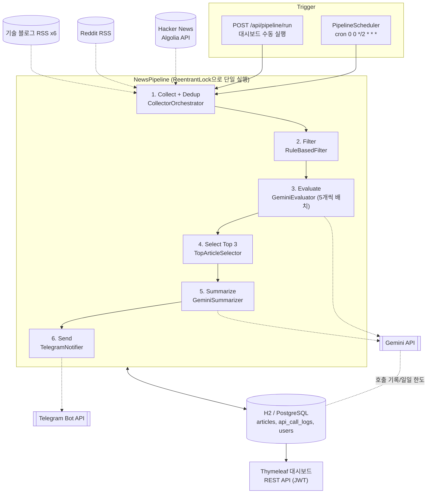
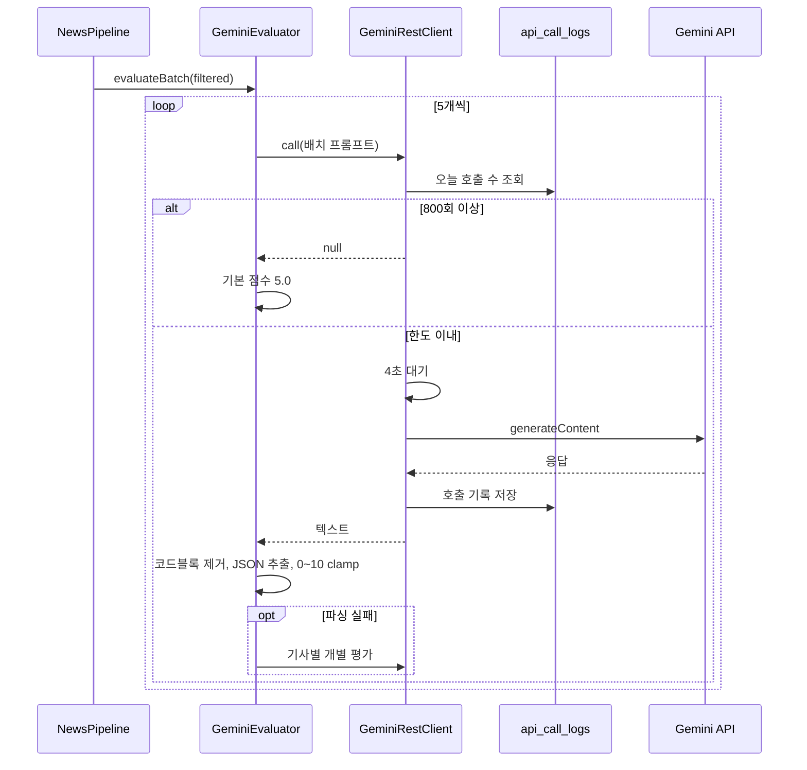

# AI News Curator

Hacker News, Reddit, 국내 기술 블로그에서 AI·백엔드 글을 모으고, Google Gemini로 채점해 2시간마다 상위 3개를 텔레그램으로 보내 주는 Spring Boot 큐레이션 서비스입니다.

[🔗 소개 페이지 열기](https://html-preview.github.io/?url=https://github.com/jsj1215/ai-news-curator/blob/main/docs/intro.html) · [docs/intro.html](docs/intro.html)

> GitHub Pages를 켜면 `https://jsj1215.github.io/ai-news-curator/docs/intro.html` 에서도 볼 수 있습니다.

## 왜 만들었나

백엔드 개발자로서 AI 소식을 따라가려면 Hacker News, Reddit, 여러 기업 기술 블로그를 매일 따로 돌아봐야 했습니다. 막상 열어 보면 채용 공고나 가벼운 뉴스, 백엔드와 상관없는 글이 많아서 읽을 만한 글을 고르는 데 시간이 더 들었습니다.

그래서 고르는 일을 파이프라인에 맡기기로 했습니다. 다만 수집한 글을 전부 LLM에 넣으면 무료 티어의 호출 한도를 금방 넘깁니다. 이 프로젝트의 설계는 대부분 "LLM 호출을 얼마나 아껴 쓰면서 쓸 만한 결과를 낼 것인가"에서 출발합니다.

- 값싼 규칙 필터로 먼저 거르고, 남은 글만 Gemini가 채점합니다.
- 채점은 5개씩 묶어서 한 번에 요청하고, 요약은 최종 선정된 3개에만 만듭니다.
- 하루 호출 수와 호출 간격을 DB 기록으로 제한합니다.

## 주요 기능

- **멀티소스 수집**: Hacker News(Algolia API), Reddit RSS(r/artificial, r/MachineLearning), 기술 블로그 RSS 6곳(네이버 D2, 카카오, 쿠팡, 우아한형제들, 라인, 당근)
- **규칙 기반 1차 필터**: 제목 길이, 게시 시점, 제외어, AI/백엔드 키워드. 키워드 목록은 `application.yml`에서 수정
- **Gemini 3축 평가**: 실용성(40%), 신선도(30%), 깊이(30%)를 0~10점으로 매기고 가중 합산
- **한국어 요약**: 상위 3개 기사를 백엔드 개발자 관점에서 2~3줄로 요약
- **텔레그램 발송**: 2시간마다 상위 3개를 봇으로 전송하고 발송 여부를 기록해 재발송을 막음
- **웹 대시보드(Thymeleaf)**: 오늘 발송분, 날짜별 히스토리, 기사 상세(점수 분해와 요약), 파이프라인 수동 실행, 통계(소스별 수집량, 평균 점수, 오늘 Gemini 호출 수)
- **REST API + JWT 인증**: 회원가입/로그인/토큰 갱신, 기사 조회 API

| 화면 | 경로 | 내용 |
|------|------|------|
| 대시보드 | `/` | 오늘 발송된 기사를 시간대별로 묶어 표시 |
| 히스토리 | `/history?date=YYYY-MM-DD` | 날짜별 발송 기사 |
| 기사 상세 | `/articles/{id}` | 점수 3종과 총점, 요약, 원문 링크 |
| 파이프라인 | `/admin/pipeline` | 실행 상태, 수동 실행 버튼, 최근 수집 기사 10건 |
| 통계 | `/admin/stats` | 총 수집/발송 수, 평균 점수, 오늘 수집 수, 오늘 Gemini 호출 수, 소스별 통계 |

텔레그램 메시지는 다음 형식으로 나갑니다(`MessageFormatter`).

```
🔥 Top 3 AI for Backend (14:00)

1. Spring AI 1.0 Released
   📝 Spring Boot에서 LLM을 네이티브로 통합하는 프레임워크가 정식 출시...
   ⭐ 8.4 | 📌 HACKER_NEWS
   🔗 https://spring.io/blog/...
```

## 시작하기

### 필수 환경

- JDK 17 (`build.gradle`의 Java toolchain이 17로 지정되어 있음)
- Gradle은 래퍼(`./gradlew`)를 쓰므로 따로 설치하지 않아도 됩니다
- Docker, Docker Compose (PostgreSQL로 실행할 때만)
- Gemini API 키, 텔레그램 봇 토큰과 채팅 ID (없어도 기동은 됩니다. 아래 참고)

### 환경변수 설정

```bash
cp .env.example .env
# .env를 열어 값을 채웁니다
```

| 변수 | 설명 | 비어 있을 때 |
|------|------|--------------|
| `GEMINI_API_KEY` | Google Gemini API 키 | 호출이 실패해 모든 기사가 기본 점수 5.0, 요약은 "요약을 생성할 수 없습니다." |
| `TELEGRAM_BOT_TOKEN` | 텔레그램 봇 토큰 | 발송 단계만 건너뜀 |
| `TELEGRAM_CHAT_ID` | 메시지를 받을 채팅 ID | 발송 단계만 건너뜀 |
| `JWT_SECRET` | JWT 서명 키, 32자 이상 | 로컬은 개발용 기본값 사용. `prod` 프로필은 기본값이 없어 반드시 설정 |
| `ADMIN_USERNAME`, `ADMIN_PASSWORD` | 관리 경로(`/admin/**`, `/api/pipeline/**`, `/h2-console`) HTTP Basic 계정 | 사용자명 `admin`, 비밀번호는 기동할 때마다 임시 값을 만들어 로그에 출력 |
| `DB_NAME`, `DB_USERNAME`, `DB_PASSWORD` | PostgreSQL 접속 정보 (prod 프로필) | `ainews` / `ainews` / `ainews` |

`application.yml`에 `spring.config.import: optional:file:.env[.properties]`가 들어 있어서, 프로젝트 루트에서 실행하면 Spring이 `.env`를 직접 읽습니다. 따로 `export`할 필요가 없습니다. `.env`는 properties 형식으로 읽히므로 값에 따옴표를 붙이지 마세요.

### 로컬 실행 (H2 파일 DB)

```bash
./gradlew bootRun
```

- 대시보드: http://localhost:8080
- 데이터는 `./data/ainews` H2 파일에 저장됩니다 (gitignore 대상)
- 관리 화면(`/admin/pipeline`, `/admin/stats`)과 H2 콘솔은 관리자 계정이 필요합니다. 브라우저가 띄우는 로그인 창에 `ADMIN_USERNAME`/`ADMIN_PASSWORD`를 입력합니다.
- H2 콘솔: http://localhost:8080/h2-console (JDBC URL `jdbc:h2:file:./data/ainews`, 사용자 `sa`)
- 스케줄(짝수 정시)까지 기다리지 않고 바로 돌려 보려면 `/admin/pipeline`의 실행 버튼을 누릅니다. 터미널에서 호출할 때는 CSRF 토큰이 필요하므로 관리 화면을 한 번 열어 쿠키를 받은 뒤 헤더로 돌려보냅니다.

```bash
curl -s -c cookies.txt -u admin:$ADMIN_PASSWORD http://localhost:8080/admin/pipeline > /dev/null
curl -X POST -b cookies.txt -u admin:$ADMIN_PASSWORD \
  -H "X-XSRF-TOKEN: $(awk '/XSRF-TOKEN/{print $7}' cookies.txt)" \
  http://localhost:8080/api/pipeline/run
```

### Docker 실행 (PostgreSQL)

```bash
docker compose up -d --build
curl http://localhost:8080/actuator/health
```

`docker-compose.yml`은 앱과 `postgres:16-alpine`을 함께 띄우고, 앱에 `SPRING_PROFILES_ACTIVE=prod`를 넘깁니다. Compose가 같은 디렉터리의 `.env`를 읽어 컨테이너 환경변수로 넣어 줍니다. `prod`에서는 `JWT_SECRET`과 `ADMIN_PASSWORD`가 필수라서, 둘 중 하나라도 비어 있으면 `docker compose`가 시작을 거부합니다. PostgreSQL 포트는 `127.0.0.1`에만 열립니다. Dockerfile은 Gradle 빌드 단계와 JRE 실행 단계로 나뉜 멀티스테이지 빌드이고, 실행 단계는 non-root 사용자로 돕니다.

## 기술 설계

### 아키텍처



### 평가 단계의 호출 흐름



### 핵심 설계 결정

**1. LLM 앞에 규칙 기반 필터를 둔다**
- 결정: 제목 10자 이상, 게시 48시간 이내, 제외어(채용, hiring, 연봉 등) 미포함, AI 또는 백엔드 키워드 포함 조건으로 먼저 거른 뒤에만 Gemini로 보냅니다. 국내 기술 블로그 글은 키워드가 없어도 통과시킵니다. (`filter/RuleBasedFilter.java`, `config/FilterConfig.java`)
- 이유: 수집한 글을 전부 LLM에 넣으면 호출 수가 수집량에 비례해 늘어납니다. 명백한 잡음은 비용이 들지 않는 규칙으로 버립니다.
- 트레이드오프: 소문자 부분 문자열 매칭이라 "ai"가 다른 단어 일부에 걸리는 식의 오탐이 있습니다. 정밀도는 다음 단계의 LLM 채점에 맡겼습니다.

**2. 5개씩 묶어 평가하고, 실패하면 단계적으로 물러선다**
- 결정: 기사 5개(`gemini.batch-size`)를 한 프롬프트로 보내 JSON 배열로 점수를 받습니다. 배치 응답을 파싱하지 못하면 기사별 개별 평가로, 그마저 실패하면 기본 점수 5.0을 줍니다. (`evaluator/GeminiEvaluator.java`)
- 이유: 호출 수를 기사 수의 약 1/5로 줄이면서, LLM 응답 하나가 깨져도 파이프라인 전체가 멈추지 않게 했습니다.
- 트레이드오프: 배치 응답이 깨지면 오히려 호출이 늘어납니다. 기본 점수는 실제 평가가 아니라서 순위를 흐릴 수 있습니다.

**3. LLM 응답을 그대로 믿지 않는다**
- 결정: 마크다운 코드블록을 지우고, 정규식으로 JSON 배열이나 객체만 뽑아낸 뒤, 점수를 0~10으로 clamp합니다. 응답에서 빠진 기사는 기본 점수로 채웁니다. temperature는 0.3입니다. (`GeminiEvaluator#cleanJsonResponse`, `GeminiEvaluatorTest`)
- 이유: "JSON만 응답하라"고 지시해도 모델이 코드블록이나 설명을 덧붙이는 경우가 있습니다.
- 대안: Gemini의 structured output(응답 스키마 지정)을 쓰면 후처리를 줄일 수 있지만, 지금은 프롬프트와 후처리로 해결했습니다. 프롬프트를 바꾸면 파서도 함께 점검해야 합니다.

**4. API 쿼터를 DB 호출 로그로 강제한다**
- 결정: Gemini를 호출할 때마다 `api_call_logs`에 기록하고, 오늘 0시 이후 호출이 800회(`gemini.daily-limit`) 이상이면 호출하지 않습니다. 호출 전에는 4초(`gemini.rpm-delay-ms`)를 기다려 분당 약 15회로 맞춥니다. 요약은 상위 3개에만 만듭니다. (`evaluator/GeminiRestClient.java`, `domain/ApiCallLog.java`)
- 이유: 무료 티어 한도를 넘기면 그 뒤 호출이 모두 실패합니다. 메모리 카운터가 아니라 DB에 남겨서 재시작해도 그날 사용량이 유지됩니다.
- 트레이드오프: `Thread.sleep` 방식이라 실행 시간이 호출 수 × 4초만큼 늘어납니다. 한도에 닿은 뒤의 기사는 기본 점수로 처리됩니다.

**5. JVM 락으로 파이프라인을 한 번에 하나만 돌린다**
- 결정: `ReentrantLock.tryLock()`으로 스케줄 실행과 수동 실행이 겹치면 뒤의 요청은 기다리지 않고 `SKIPPED`를 돌려줍니다. (`pipeline/NewsPipeline.java`, `PipelineControllerTest`)
- 이유: 두 번이 동시에 돌면 같은 기사를 두 번 평가하고 두 번 보낼 수 있고, 쿼터도 두 배로 씁니다.
- 트레이드오프: 인스턴스가 하나라는 전제입니다. 여러 대로 늘리면 ShedLock 같은 분산 락이 필요합니다.

**6. 수집기는 인터페이스로 분리하고 실패는 격리한다**
- 결정: `ArticleCollector` 구현체를 `List`로 주입받아 차례로 실행합니다. 하나가 예외를 던져도 로그만 남기고 다음 수집기로 넘어갑니다. 중복은 `url` 유니크 인덱스와 `existsByUrl` 확인으로 막습니다. (`collector/CollectorOrchestrator.java`, `CollectorOrchestratorTest`)
- 이유: RSS 피드 하나가 응답하지 않는 일은 흔합니다. 새 소스를 붙일 때는 구현체 하나와 설정만 추가하면 됩니다.
- 트레이드오프: 수집기가 순차 실행이라 느린 피드가 전체를 늦춥니다. 같은 글이 다른 URL로 올라오면 중복으로 잡지 못합니다.

### 데이터 모델

| 엔티티 (테이블) | 주요 필드 |
|----------------|-----------|
| `Article` (`articles`) | title, url(unique), source, content, publishedAt, collectedAt, practicalityScore, freshnessScore, depthScore, totalScore, summary, sent, sentAt |
| `ApiCallLog` (`api_call_logs`) | apiName, calledAt(인덱스) |
| `User` (`users`) | name, email(unique), password(BCrypt) |

스키마는 JPA가 만듭니다(`spring.jpa.hibernate.ddl-auto: update`). 별도 마이그레이션 스크립트는 없습니다.

### REST API

| 메서드 | 경로 | 인증 | 설명 |
|--------|------|------|------|
| POST | `/api/auth/signup` | - | 회원가입, Access/Refresh 토큰 발급 |
| POST | `/api/auth/login` | - | 로그인, 토큰 발급 |
| POST | `/api/auth/refresh` | - | Refresh 토큰으로 재발급 |
| GET | `/api/articles/today` | JWT | 오늘 발송된 기사(시간대별 그룹) |
| GET | `/api/articles/history?date=2026-03-31` | JWT | 날짜별 발송 기사 |
| GET | `/api/articles/{id}` | JWT | 기사 상세 |
| GET | `/api/articles/dates` | JWT | 발송 이력이 있는 날짜 목록 |
| POST | `/api/pipeline/run` | 관리자 + CSRF | 파이프라인 수동 실행 |
| GET | `/api/pipeline/status` | 관리자 | 실행 중 여부 |
| GET | `/actuator/health` | - | 헬스 체크 |

## 기술 스택

| 분류 | 기술 |
|------|------|
| 언어 | Java 17 |
| 프레임워크 | Spring Boot 3.4.4 (Web, Data JPA, Security, Validation, Actuator) |
| AI | Google Gemini API `gemini-2.5-flash-lite` (REST 직접 호출) |
| DB | H2 (기본 프로필), PostgreSQL 16 (`prod` 프로필) |
| 화면 | Thymeleaf + Thymeleaf Layout Dialect, Vanilla CSS/JS |
| 수집 | Rome 2.1 (RSS/Atom), RestTemplate, Java HttpClient |
| 인증 | Spring Security, jjwt 0.12, BCrypt |
| 알림 | Telegram Bot API |
| 빌드/배포 | Gradle, Docker 멀티스테이지 빌드, Docker Compose |
| CI | GitHub Actions |
| 테스트 | JUnit 5, Mockito, Spring Boot Test, Spring Security Test |

## 프로젝트 구조

```
ai-news-curator/
├── src/main/java/com/curator/ainews/
│   ├── collector/      # ArticleCollector 구현체 (HN, Reddit, 기술 블로그)와 오케스트레이터
│   ├── filter/         # 규칙 기반 필터
│   ├── evaluator/      # GeminiClient 인터페이스, REST 구현체, 평가기, 요약기
│   ├── selector/       # 상위 N개 선정
│   ├── notification/   # 텔레그램 발송, 메시지 포맷
│   ├── pipeline/       # NewsPipeline, 수동 실행 API
│   ├── scheduler/      # cron 스케줄러
│   ├── domain/         # JPA 엔티티, 리포지토리, 기사 조회 API
│   ├── auth/           # JWT 발급/검증, 인증 API
│   ├── config/         # Security, 수집/필터 설정 바인딩
│   └── web/            # Thymeleaf 화면 컨트롤러
├── src/main/resources/
│   ├── application.yml         # 기본 설정 (H2, 키워드, 피드, 가중치, 스케줄)
│   ├── application-prod.yml    # PostgreSQL, 로그 설정
│   ├── templates/              # Thymeleaf 페이지
│   └── static/                 # CSS, JS
├── src/test/java/...           # 테스트 클래스 14개
├── docs/intro.html             # 소개 페이지
├── Dockerfile
├── docker-compose.yml
└── .github/workflows/ci.yml
```

## 테스트

```bash
./gradlew test
```

테스트는 `src/test/resources/application.yml`을 쓰며 H2 인메모리 DB에서 돌아갑니다. Gemini, 텔레그램, HN 같은 외부 API는 Mock으로 대체하므로 키가 없어도 실행됩니다. 테스트 클래스 14개, 테스트 메서드 89개로 구성되어 있습니다.

| 종류 | 대상 |
|------|------|
| 단위 (Mockito) | `RuleBasedFilter`, `TopArticleSelector`, `GeminiEvaluator`(배치 파싱, 코드블록 응답, null 응답, 개별 평가 폴백, 점수 clamp), `GeminiSummarizer`, `MessageFormatter`, `CollectorOrchestrator`(URL 중복 제거, 수집기 실패 격리) |
| 통합 (`@SpringBootTest`, `@DataJpaTest`) | `AuthController`(가입, 로그인, 토큰 갱신), `ArticleController`(JWT 필요 여부, 날짜별 조회), `PipelineController`(수동 실행, 중복 실행 시 SKIPPED, 미인증 401, 잘못된 비밀번호 401, CSRF 토큰 없음 403), `ArticleRepository` 쿼리 |
| 수집기 | `HackerNewsCollector`(Algolia 응답 파싱), `RedditCollector`, `TechBlogCollector`(빈 설정, 잘못된 피드 URL 처리) |

GitHub Actions(`.github/workflows/ci.yml`)가 `main` 브랜치 push와 PR마다 JDK 17로 빌드와 테스트를 돌리고 테스트 리포트를 아티팩트로 올립니다. `main` push에서는 Docker 이미지 빌드까지 확인합니다.

## 보안과 환경변수 메모

- API 키, 봇 토큰, JWT 시크릿은 코드에 두지 않고 환경변수로 주입합니다. 로컬에서는 gitignore된 `.env`를 Spring이 읽고, Docker에서는 Compose가 같은 파일을 컨테이너 환경변수로 넘깁니다. `.env.example`에는 자리표시자만 들어 있습니다.
- 비밀번호는 BCrypt로 해시하고, 인증은 세션 없는 JWT(Access 30분, Refresh 7일)로 처리합니다. CORS는 `http://localhost:3000`만 허용합니다.
- 관리 경로(`/admin/**`, `/api/pipeline/**`, `/h2-console`)는 별도 `SecurityFilterChain`에서 HTTP Basic으로 보호합니다. 수동 실행은 Gemini 쿼터를 쓰기 때문에 공개하지 않습니다. 브라우저가 자격 증명을 자동으로 붙이는 방식이라 CSRF 보호를 함께 켜고, 관리자 계정은 이 체인에만 연결해 회원용 JWT 인증과 섞이지 않게 했습니다. H2 콘솔은 DispatcherServlet 밖의 서블릿이라 `AntPathRequestMatcher`로 매칭합니다 (`config/SecurityConfig.java`).
- Gemini API 키는 URL 쿼리가 아니라 `x-goog-api-key` 헤더로 보내서 예외 메시지나 접근 로그에 키가 남지 않게 했습니다.
- `prod` 프로필은 `JWT_SECRET`, `ADMIN_PASSWORD`에 기본값을 두지 않습니다.
- 컨테이너는 non-root 사용자로 실행되고, `prod` 프로필에서는 H2 콘솔이 꺼집니다.

이 서버를 외부에 공개해 운영하려면 다음을 먼저 손봐야 합니다.

- 관리자 계정이 하나뿐이고 HTTP Basic이라, 외부에 공개할 때는 HTTPS 뒤에 두어야 합니다.
- Refresh 토큰을 저장하지 않아 만료 전에 강제로 무효화할 수 없습니다.
- 기사 데이터는 웹 화면에서는 공개, REST API에서는 JWT가 필요해 권한 기준이 일관되지 않습니다.

## 계획

`PLAN.md`에 남아 있는 미완료 항목입니다.

- README 스크린샷 (대시보드, 텔레그램 알림)
- Swagger/SpringDoc API 문서

## 라이선스

개인 포트폴리오 용도로 공개한 프로젝트입니다.
